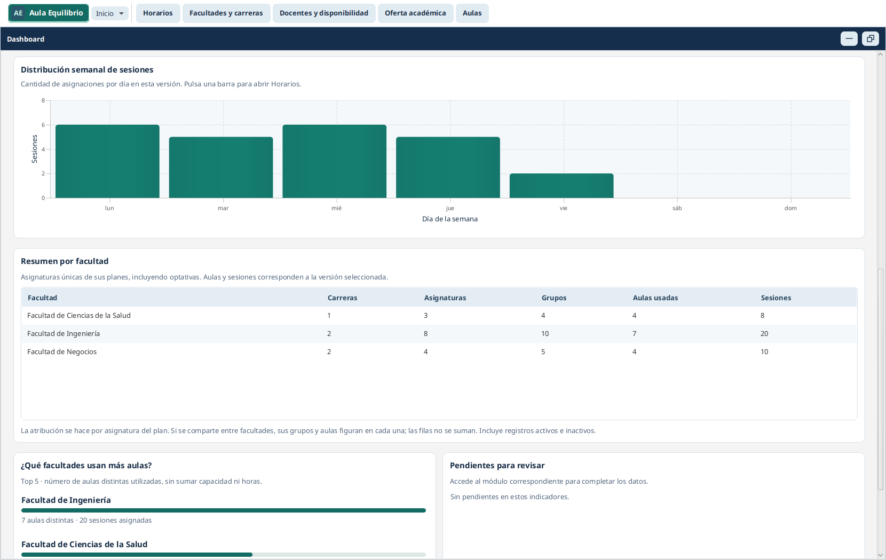
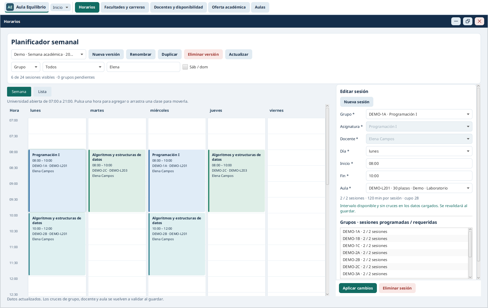
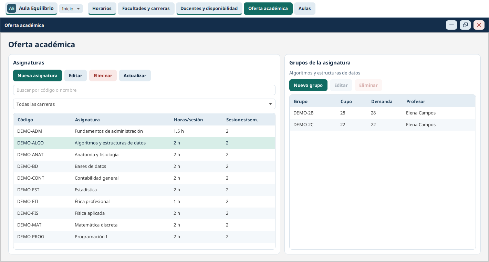

# Aula Equilibrio

Proyecto final de la asignatura **Programación de Aplicaciones de Escritorio**. Aula Equilibrio es una aplicación de escritorio para organizar horarios universitarios y coordinar los grupos, los docentes y las aulas que necesitan.

Al armar un horario hay que evitar que un grupo, un docente o un aula tenga dos clases a la vez. También hay que encontrar un salón libre con capacidad suficiente y respetar la disponibilidad del docente. Aula Equilibrio reúne esos datos, valida cada sesión antes de guardarla y permite comparar versiones del horario.

## Ejecutar el proyecto

Necesitas **JDK 21** y **PostgreSQL** en marcha. Ejecuta los comandos desde la raíz del proyecto.

1. Crea la base `aulaequilibrio` si todavía no existe. Reemplaza `TU_USUARIO` por tu usuario de PostgreSQL. Ese usuario debe poder crear la base y sus tablas.

   ```bash
   createdb -h localhost -p 5432 -U TU_USUARIO aulaequilibrio
   ```

2. Si todavía no tienes `.env`, créalo a partir del archivo de ejemplo.

   ```bash
   cp .env.example .env
   ```

   En PowerShell, usa `Copy-Item .env.example .env`. Configura en `.env` la URL de conexión, como `DB_URL=jdbc:postgresql://localhost:5432/aulaequilibrio`, junto con `DB_USER` y `DB_PASSWORD`. También puedes definirlos como variables de entorno.

3. Inicia la aplicación.

   ```bash
   ./mvnw javafx:run
   ```

   En Windows, usa `.\mvnw.cmd javafx:run`. En IntelliJ IDEA, abre el `pom.xml` como proyecto Maven, selecciona JDK 21 y ejecuta `Launcher` con la raíz del proyecto como directorio de trabajo.

El primer arranque prepara las tablas y carga [los datos de demostración](sql/demo_seed.sql). En una base nueva encontrarás 3 facultades, 5 carreras, 10 asignaturas, 8 docentes, 12 grupos, 8 aulas y un horario de 24 sesiones.

La aplicación abre el dashboard en pantalla completa. Pulsa **Esc** para volver al modo ventana. Abre los módulos desde la barra superior o usa **Inicio → Organizar en cascada** para ver varias ventanas internas.

## Ejecutar las pruebas

```bash
./mvnw test
```

En Windows, usa `.\mvnw.cmd test`. Las pruebas cubren los catálogos, el dashboard y el planificador, incluidos los cruces, la disponibilidad, la separación entre versiones y la edición simultánea. Usan una base temporal **H2** y se pueden ejecutar sin PostgreSQL ni `.env`.

Las pruebas de interfaz JavaFX se omiten cuando `DISPLAY` no está definido. Si trabajas sin entorno gráfico, puedes ejecutarlas con una pantalla virtual mediante `xvfb-run -a ./mvnw test`. GitHub Actions ejecuta `./mvnw verify` con una pantalla virtual.

## Funcionalidades

Las capturas muestran la aplicación con los datos de demostración.

### Dashboard

Consulta la cobertura de sesiones, los pendientes y el uso de aulas de la versión seleccionada. Las gráficas resumen el estado de las aulas y las sesiones por día. La tabla permite revisar la actividad por facultad.




### Horarios y validación de cruces

En **Horarios**, selecciona **Demo · Semana académica**. Pulsa una clase para editarla, arrástrala para cambiar su día u hora o usa **Lista** para ver las sesiones en una tabla. Puedes filtrar por grupo, docente o aula. Usa **Duplicar** para probar cambios en una versión independiente.



Para ver cómo se detecta un cruce, selecciona una clase y pulsa **Nueva sesión**. El editor conserva el grupo, el día y la hora de inicio. Al intentar repetir ese intervalo, muestra el cruce y deshabilita **Agregar sesión**. El planificador también comprueba la duración de la clase, la disponibilidad docente y la capacidad, el estado y la ocupación del aula. Las sesiones deben quedar entre las **07:00 y las 21:00**.


### Docentes y disponibilidad

Selecciona un docente para ver y editar sus intervalos de disponibilidad. En los datos de ejemplo, selecciona a Elena y luego a Mateo para comprobar cómo cambia la lista de intervalos. El planificador usa estos datos para evitar asignar clases fuera de la disponibilidad registrada.


### Oferta académica

Consulta las asignaturas y los grupos que pertenecen a cada una. Puedes definir los minutos y las sesiones semanales de una asignatura, indicar si es obligatoria u optativa en cada carrera, y asignar un docente y un cupo a cada grupo.



### Aulas y tipos de aula

Registra aulas con código, capacidad, tipo y estado. Selecciona un tipo en el panel derecho para filtrar el listado. El estado **Disponible** indica que el aula está habilitada. Para asignarla, también debe estar libre en el intervalo y tener capacidad para el grupo.


### Facultades y carreras

Organiza la estructura académica. Al seleccionar una facultad, la tabla de la derecha muestra las carreras que pertenecen a ella.


## Stack y bases de versiones anteriores

La interfaz usa **JavaFX y FXML**. La lógica de negocio vive en los servicios y la persistencia en los DAO, con **Hibernate y PostgreSQL**. Maven Wrapper compila el proyecto y ejecuta las pruebas con JUnit.

Si reutilizas una base con aulas de una versión anterior, revisa primero la [guía de migración de aulas](docs/ROLANDO_AULAS.md). Al arrancar, la aplicación ejecuta la [migración de intervalos](sql/migrate_time_intervals.sql). Las sesiones antiguas cuyas horas no se pueden recuperar de forma inequívoca quedan pendientes de revisión en **Horarios → Lista**.
