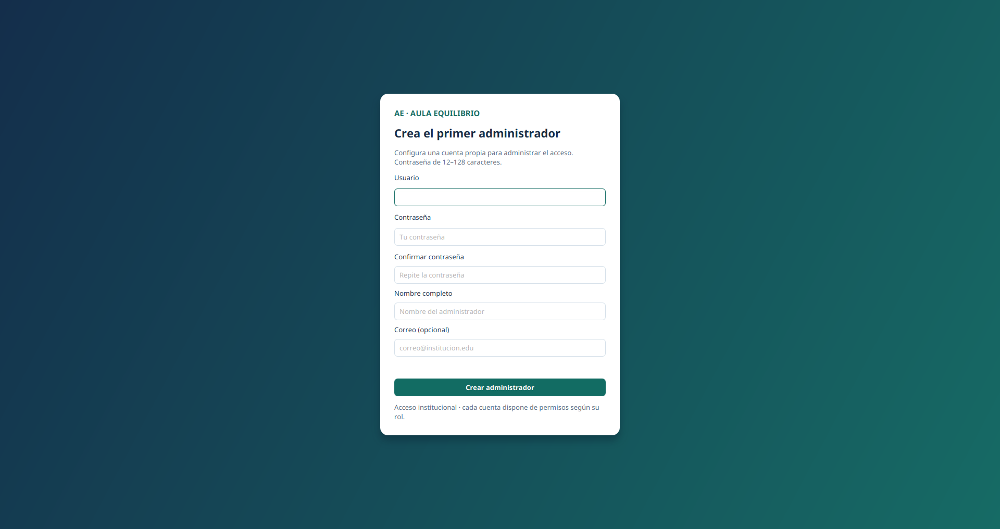
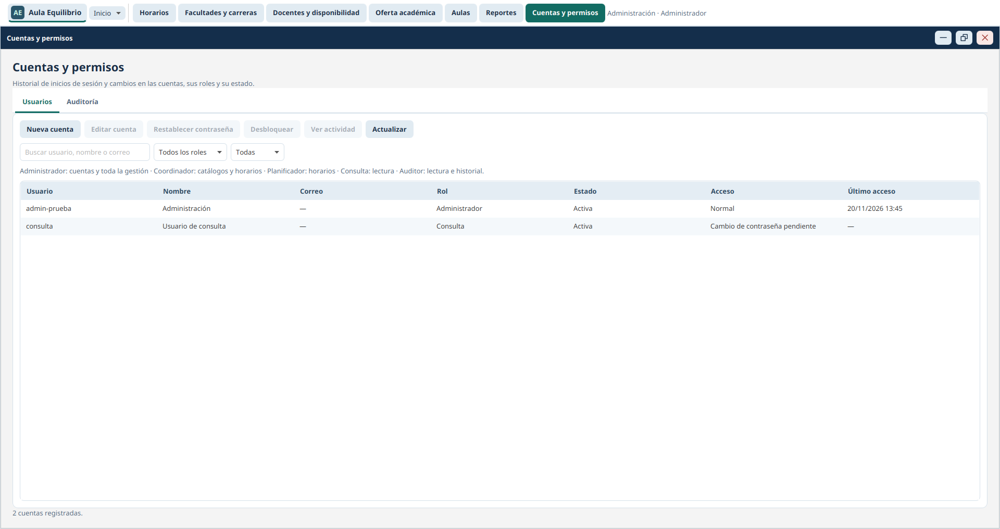
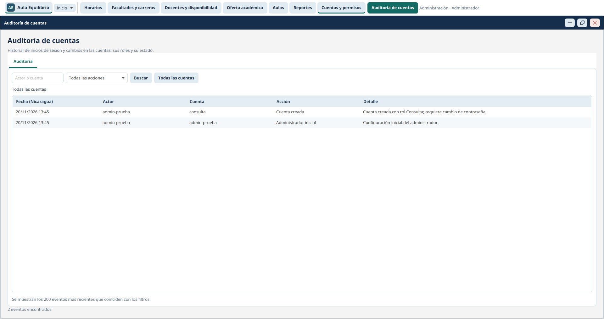
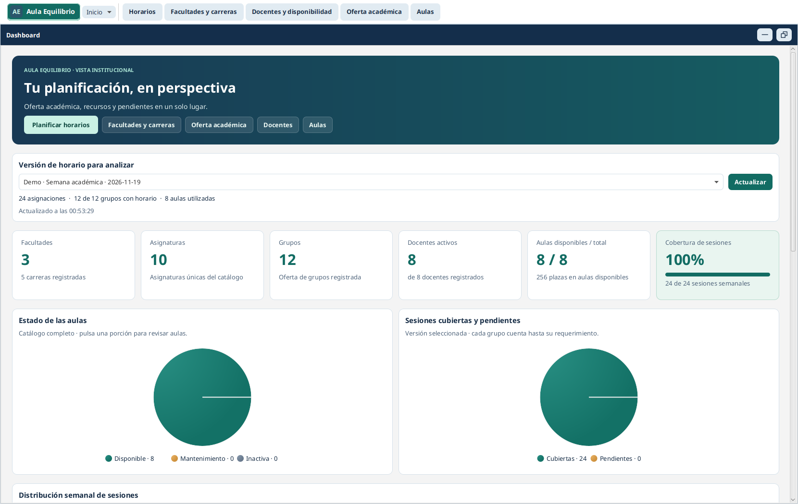
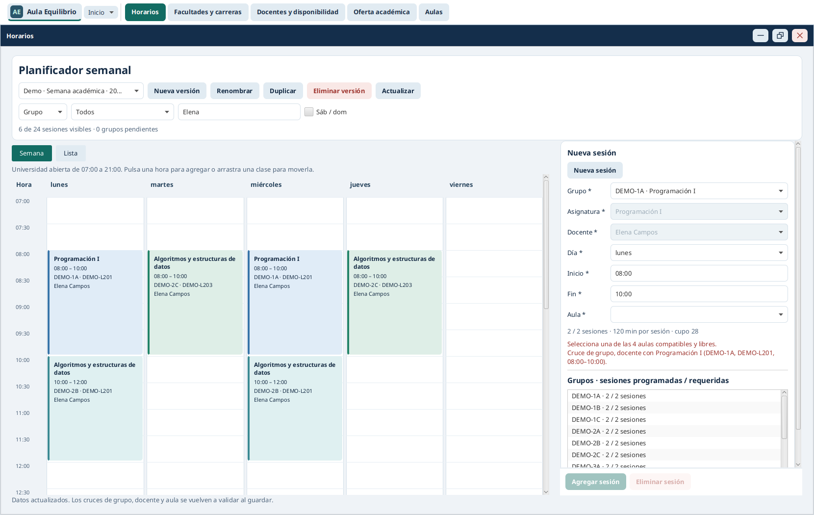
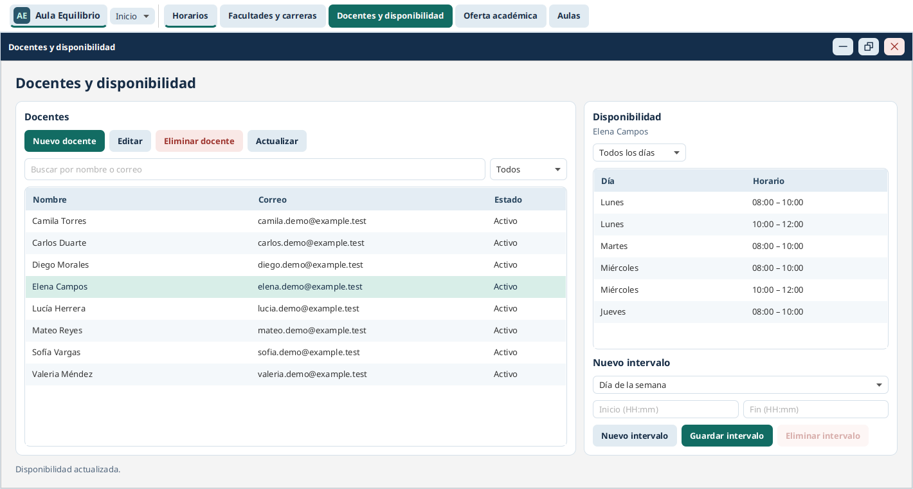
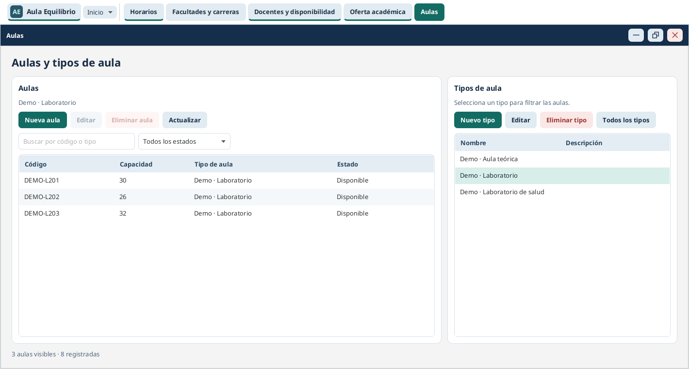
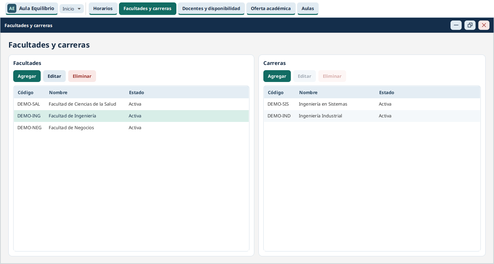

# Aula Equilibrio

Proyecto final de la asignatura **Programación de Aplicaciones de Escritorio**. Aula Equilibrio es una aplicación de escritorio para organizar horarios universitarios y coordinar los grupos, los docentes y las aulas que necesitan.

Al armar un horario hay que evitar que un grupo, un docente o un aula tenga dos clases a la vez. También hay que encontrar un salón libre con capacidad suficiente y respetar la disponibilidad del docente. Aula Equilibrio reúne esos datos, valida cada sesión antes de guardarla y permite comparar versiones del horario.

## Ejecutar el proyecto

Necesitas **JDK 21** y **PostgreSQL** en marcha. Ejecuta los comandos desde la raíz del proyecto.

1. Crea la base `aulaequilibrio` si todavía no existe. Reemplaza `TU_USUARIO` por tu usuario de PostgreSQL. Ese usuario debe poder crear la base y sus tablas.

   ```bash
   createdb -h localhost -p 5432 -U TU_USUARIO aulaequilibrio
   ```

2. Si todavía no tienes `.env`, créalo a partir del archivo de ejemplo.

   ```bash
   cp .env.example .env
   ```

   En PowerShell, usa `Copy-Item .env.example .env`. Configura en `.env` la URL de conexión, como `DB_URL=jdbc:postgresql://localhost:5432/aulaequilibrio`, junto con `DB_USER` y `DB_PASSWORD`. También puedes definirlos como variables de entorno.

3. Inicia la aplicación.

   ```bash
   ./mvnw javafx:run
   ```

   En Windows, usa `.\mvnw.cmd javafx:run`. En IntelliJ IDEA, abre el `pom.xml` como proyecto Maven, selecciona JDK 21 y ejecuta `Launcher` con la raíz del proyecto como directorio de trabajo.

El primer arranque prepara las tablas y carga [los datos de demostración](sql/demo_seed.sql). En una base nueva encontrarás 3 facultades, 5 carreras, 10 asignaturas, 8 docentes, 12 grupos, 8 aulas y un horario de 24 sesiones.

La aplicación abre el acceso en pantalla completa. En la primera ejecución aparece el formulario para crear el administrador: elige tu usuario y una contraseña propia. La semilla no crea cuentas ni contraseñas predeterminadas. Una vez autenticado se abre el dashboard. Pulsa **Esc** para volver al modo ventana; cambiar de sesión conserva el tamaño de la aplicación. Abre los módulos desde la barra superior o usa **Inicio → Organizar en cascada** para ver varias ventanas internas.

## Usuarios, roles y auditoría

Las cuentas se guardan con Hibernate en PostgreSQL, separadas de los docentes. Cada usuario tiene un rol persistente. Los permisos se comprueban en los servicios antes de consultar o modificar datos; las pantallas de lectura ocultan los controles de edición.

| Rol | Capacidades |
| --- | --- |
| Administrador | Toda la gestión académica, cuentas, roles y auditoría. |
| Coordinador | Editar facultades/carreras, docentes/disponibilidad, oferta académica, aulas y horarios. |
| Planificador | Consultar catálogos y reportes; crear, editar y eliminar versiones y sesiones de horario. |
| Consulta | Consultar dashboard, catálogos, horarios y reportes; exportar reportes. |
| Auditor | Las consultas anteriores y el historial de cuentas, sin gestionar usuarios ni modificar datos académicos. |

El administrador abre **Inicio → Cuentas y permisos** para crear usuarios, modificar nombre/correo, asignar roles, activar o desactivar cuentas, desbloquear accesos y restablecer contraseñas. Las cuentas se desactivan para conservar su historial. El identificador de acceso permanece estable. No puedes cambiar tu propio rol o estado desde ese panel y se protege la existencia de un administrador activo.

Las cuentas nuevas y los restablecimientos usan una contraseña temporal elegida por el administrador; la persona debe cambiarla antes de acceder al escritorio. **Inicio → Cambiar mi contraseña** permite cambiar la propia, y **Cerrar sesión** devuelve al acceso. No hay recuperación por correo: el administrador restablece el acceso desde el panel.

**Inicio → Auditoría de cuentas** muestra quién realizó cada acción, sobre qué cuenta y cuándo, con filtros por actor/cuenta y acción. El administrador puede seleccionar una cuenta y usar **Ver actividad**. Se muestran los 200 eventos más recientes; un doble clic abre el detalle. Se registran creación y modificación de cuentas, accesos correctos/rechazados, cierres de sesión, cambios/restablecimientos de contraseña y desbloqueos. Los eventos no almacenan contraseñas ni hashes, y no hay controles para editarlos o borrarlos.

Las contraseñas de 12–128 caracteres se almacenan como **PBKDF2-HMAC-SHA256, 600 000 iteraciones y sal aleatoria por cuenta**, siguiendo los parámetros publicados por [OWASP](https://cheatsheetseries.owasp.org/cheatsheets/Password_Storage_Cheat_Sheet.html). Las sesiones usan tokens aleatorios, de los que la base conserva únicamente el hash, y caducan a las 12 horas. Un cambio de rol/estado o contraseña revoca las sesiones anteriores. Cinco accesos fallidos bloquean temporalmente la cuenta durante 15 minutos; el administrador puede desbloquearla. La cuenta inicial se crea una sola vez mediante una transacción serializada, incluso si se abren dos instancias simultáneamente.

Las nuevas tablas son `user_role`, `user_account`, `login_session` y `account_audit`. La actualización es aditiva y no reemplaza los datos académicos existentes.







## Ejecutar las pruebas

```bash
./mvnw test
```

En Windows, usa `.\mvnw.cmd test`. Las pruebas cubren los catálogos, el dashboard y el planificador, incluidos los cruces, la disponibilidad, la separación entre versiones y la edición simultánea. Usan una base temporal **H2** y se pueden ejecutar sin PostgreSQL ni `.env`.

Las pruebas de interfaz JavaFX se omiten cuando `DISPLAY` no está definido. Si trabajas sin entorno gráfico, puedes ejecutarlas con una pantalla virtual mediante `xvfb-run -a ./mvnw test`. GitHub Actions ejecuta `./mvnw verify` con una pantalla virtual.

## Funcionalidades

Las capturas muestran la aplicación con los datos de demostración.

### Dashboard

Consulta la cobertura de sesiones, los pendientes y el uso de aulas de la versión seleccionada. Las gráficas resumen el estado de las aulas y las sesiones por día. La tabla permite revisar la actividad por facultad.




### Horarios y validación de cruces

En **Horarios**, selecciona **Demo · Semana académica**. Pulsa una clase para editarla, arrástrala para cambiar su día u hora o usa **Lista** para ver las sesiones en una tabla. Puedes filtrar por grupo, docente o aula. Usa **Duplicar** para probar cambios en una versión independiente.


Para ver cómo se detecta un cruce, selecciona una clase y pulsa **Nueva sesión**. El editor conserva el grupo, el día y la hora de inicio. Al intentar repetir ese intervalo, muestra el cruce y deshabilita **Agregar sesión**. El planificador también comprueba la duración de la clase, la disponibilidad docente y la capacidad, el estado y la ocupación del aula. Las sesiones deben quedar entre las **07:00 y las 21:00**.



### Reportes

Abre **Reportes** desde la barra superior.

- **Horario** lista las sesiones de una versión y permite filtrarlas por grupo, docente o aula.
- **Carga docente** compara las horas asignadas con la disponibilidad semanal del docente. Cuando no hay disponibilidad registrada, el uso aparece como **—**.
- **Ocupación de aulas** muestra las sesiones y horas reservadas de cada aula por versión y día o semana. El porcentaje usa una jornada de **07:00 a 21:00** de lunes a domingo. Para aulas en mantenimiento o inactivas se muestra **—**.
- **Cobertura por grupo** compara las sesiones requeridas y programadas en cada versión. Muestra las pendientes y permite filtrar los grupos incompletos.

Cada pestaña permite **Actualizar**, abrir una **Vista previa** paginada para impresión y exportar su selección con JasperReports a **PDF** o **Excel (.xlsx)**. Puedes editar los diseños `.jrxml` con Jaspersoft Studio 7.0.x. Consulta la [guía de reportes](docs/REPORTES.md) para crear o modificar un diseño.

### Probar las dos API

#### API propia de consulta de horarios

1. Inicia primero Aula Equilibrio con tu base local para que existan las tablas y alguna versión de horario. Agrega `AULA_API_TOKEN` con un valor propio en tu `.env`. El puerto predeterminado es `8080` y puedes cambiarlo con `AULA_API_PORT`.
2. En otra terminal, desde la raíz del repositorio, inicia el servidor REST local con Java 21:

   ```powershell
   .\mvnw.cmd -Papi-horarios compile exec:java
   ```

   En Linux o macOS usa `./mvnw -Papi-horarios compile exec:java`.

3. En Postman elige el método **GET** y en **Authorization → Bearer Token** pega el valor de `AULA_API_TOKEN`.

   | URL | Respuesta |
   | --- | --- |
   | `http://127.0.0.1:8080/api/horarios/versiones` | Lista las versiones y sus identificadores. |
   | `http://127.0.0.1:8080/api/horarios/versiones/1/sesiones` | Devuelve las sesiones con intervalo definido en la versión. Sustituye `1` por el ID de la primera respuesta. |
   | `http://127.0.0.1:8080/api/horarios/versiones/1/sesiones?grupoId=7` | Filtra por grupo. También acepta `docenteId` y `aulaId`, combinables. Usa los IDs que aparecen en la respuesta sin filtro. |

La API escucha en `127.0.0.1` y consulta la misma base PostgreSQL en modo de lectura. Puedes iniciarla desde IntelliJ ejecutando `ScheduleApiLauncher` con el proyecto como directorio de trabajo. Para demostrar la integración, guarda una sesión desde JavaFX y repite la consulta en Postman. Sin token válido responde `401`, con filtros inválidos `400` y para una versión inexistente `404`.

#### Consumo de la API de Resend

1. Crea una clave de envío en Resend. En tu `.env` local agrega `RESEND_API_KEY` y `RESEND_FROM`. Para la prueba usa `RESEND_FROM=onboarding@resend.dev` y pon el correo de tu cuenta de Resend en un docente de demostración. Para enviar a otros destinatarios configura un remitente de un dominio verificado en Resend.
2. Entra a Aula Equilibrio como **Administrador** o **Coordinador**. Ve a **Reportes → Horario**, selecciona una versión con sesiones y filtra por **Docente**.
3. Pulsa **Enviar por correo**, revisa la dirección y confirma. El sistema prepara el PDF con las sesiones filtradas, llama a Resend y muestra su identificador si el servicio acepta el envío. Para una prueba real, abre el correo de demostración y comprueba el adjunto.

Los valores de la clave de Resend y el token REST van en `.env` local. `.env.example` contiene solamente los nombres de las variables. La generación y exportación de reportes funciona con la configuración de PostgreSQL aunque Resend aún no esté configurado.

### Docentes y disponibilidad

Selecciona un docente para ver y editar sus intervalos de disponibilidad. En los datos de ejemplo, selecciona a Elena y luego a Mateo para comprobar cómo cambia la lista de intervalos. El planificador usa estos datos para evitar asignar clases fuera de la disponibilidad registrada.



### Oferta académica

Consulta las asignaturas y los grupos que pertenecen a cada una. Puedes definir los minutos y las sesiones semanales de una asignatura, indicar si es obligatoria u optativa en cada carrera, y asignar un docente y un cupo a cada grupo.


### Aulas y tipos de aula

Registra aulas con código, capacidad, tipo y estado. Selecciona un tipo en el panel derecho para filtrar el listado. El estado **Disponible** indica que el aula está habilitada. Para asignarla, también debe estar libre en el intervalo y tener capacidad para el grupo.



### Facultades y carreras

Organiza la estructura académica. Al seleccionar una facultad, la tabla de la derecha muestra las carreras que pertenecen a ella.



## Stack y bases de versiones anteriores

La interfaz usa **JavaFX y FXML**. La lógica de negocio vive en los servicios y la persistencia en los DAO, con **Hibernate y PostgreSQL**. Maven Wrapper compila el proyecto y ejecuta las pruebas con JUnit.

Si reutilizas una base con aulas de una versión anterior, revisa primero la [guía de migración de aulas](docs/ROLANDO_AULAS.md). Al arrancar, la aplicación ejecuta la [migración de intervalos](sql/migrate_time_intervals.sql). Las sesiones antiguas cuyas horas no se pueden recuperar de forma inequívoca quedan pendientes de revisión en **Horarios → Lista**.
